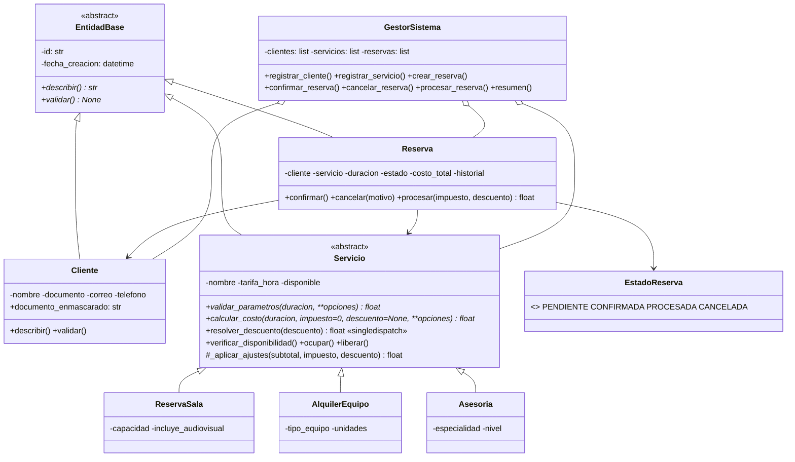

# Etapa 1 y 2 – Análisis, diseño y trazabilidad

**Curso:** Programación 213023 – Fase 4 · **Grupo de referencia:** 213023_475 · **Modalidad:** individual (autorizada por la tutora)
**Fuentes:** *Guía para el desarrollo del componente práctico – Fase 4* (en adelante **G**) y *Anexo 3 – Problema a desarrollar Fase 4*, Ejercicio 1 (en adelante **A3**).

## 1. Requisitos extraídos de los documentos

| ID | Requisito (texto fuente resumido) | Fuente |
|----|-----------------------------------|--------|
| R01 | Sistema orientado a objetos que gestione clientes, servicios y reservas para "Software FJ" | A3 p.1 |
| R02 | Servicios: reservas de salas, alquiler de equipos y asesorías especializadas | A3 p.1 |
| R03 | Sin bases de datos: gestión con objetos, listas y archivos solo para logs | A3 p.1, p.3 |
| R04 | Aplicación estable, modular y extensible | A3 p.1 |
| R05 | Abstracción, herencia, polimorfismo y encapsulación | A3 p.1 |
| R06 | Clases abstractas, clases derivadas, métodos sobrecargados, listas internas, validaciones estrictas | A3 p.1 |
| R07 | Excepciones personalizadas | A3 p.2 |
| R08 | Bloques try/except, try/except/else, try/except/finally | A3 p.2 |
| R09 | Encadenamiento de excepciones | A3 p.2 |
| R10 | Cada error se registra en un archivo de logs; la aplicación se mantiene activa | A3 p.2 |
| R11 | Manejar: datos inválidos, parámetros faltantes, operaciones no permitidas, reservas incorrectas, servicios no disponibles, cálculos inconsistentes | A3 p.2 |
| R12 | Clase abstracta para entidades generales del sistema | A3 p.2 |
| R13 | Clase Cliente con validaciones robustas y encapsulación de datos personales | A3 p.2 |
| R14 | Clase abstracta Servicio y ≥ 3 servicios que hereden, con métodos sobrescritos para calcular costos, describir y validar parámetros | A3 p.2 |
| R15 | Clase Reserva (cliente, servicio, duración, estado) con confirmación, cancelación y procesamiento con manejo de excepciones | A3 p.2 |
| R16 | Métodos sobrecargados: variantes de cálculo de costos con impuestos, descuentos, parámetros opcionales | A3 p.2 |
| R17 | Archivo de logs con todos los errores y eventos relevantes | A3 p.3 |
| R18 | Simular ≥ 10 operaciones completas: clientes válidos/inválidos, servicios correctos/incorrectos, reservas exitosas/fallidas | A3 p.3 |
| R19 | Proyecto único, funcional, organizado, documentado, que se ejecute sin interrupciones | A3 p.3 |
| R20 | Desarrollar el ejercicio en GitHub; el enlace se comparte en el foro | G §3 |
| R21 | Documentar cada línea de código de manera clara y precisa | G §3 |
| R22 | Ejecutar de forma secuencial cada segmento del código y aplicar correcciones | G §3 |
| R23 | PDF con portada, introducción, enlace del repositorio, conclusiones y referencias APA | G §3 |
| R24 | Cumplir ortografía y evitar plagio (Turnitin, acuerdo 029 de 2013) | G §4–5 |

## 2. Ambigüedades identificadas y decisión tomada

| # | Ambigüedad | Decisión (sin inventar requisitos) |
|---|------------|-------------------------------------|
| 1 | G y A3 piden equipo de 5 estudiantes y participación de todos. | La tutora autorizó modalidad individual. El repositorio y el informe lo declaran; no se simulan integrantes ni contribuciones ajenas. |
| 2 | G indica "Cada estudiante debe ingresar al repositorio creado en GitHub para el proyecto de su grupo". | Antes de publicar se confirmó con el estudiante que la tutora autorizó un repositorio individual; se publicó como repositorio público para compartir el enlace en el foro. |
| 3 | G §4 dice "cumplir con las normas *Elija un elemento*" (campo de plantilla sin diligenciar). | Se usa APA 7.ª edición, coherente con G §3 ("Referencias bibliográficas normas apa"). |
| 4 | "Métodos sobrecargados": Python no tiene sobrecarga clásica por firma. | Se implementa con parámetros opcionales (`calcular_costo(duracion[, impuesto[, descuento]], **opciones)`) y con sobrecarga por tipo (`functools.singledispatchmethod` en `resolver_descuento`). Se documenta la limitación. |
| 5 | "Documentar cada línea": comentar literalmente cada línea reduce la legibilidad. | Docstring en todo módulo/clase/método y comentario en cada instrucción con lógica no evidente. |
| 6 | No se fijan tarifas, IVA, límites de duración ni reglas comerciales. | Se definen como constantes de clase visibles y modificables (IVA 19 % de Colombia, descuento máx. 50 %, rangos de duración). Son supuestos de diseño, no requisitos. |
| 7 | "Operación completa" no está definida. | Se entiende como una acción de negocio de inicio a fin (registrar, crear, reservar, confirmar, procesar, cancelar) con su resultado y registro en log. Se simulan 30. |
| 8 | Fecha de cierre en G: domingo 22 de noviembre de 2026. | Se informa al estudiante; cualquier entrega extemporánea depende de la tutora. |

## 3. Arquitectura propuesta

```
03_Desarrollo/
├── main.py                  # Simulación de 30 operaciones (capa de aplicación)
├── evidencia_error_inesperado.py  # Evidencia de error no previsto (ZeroDivisionError)
├── software_fj/             # Paquete del dominio
│   ├── excepciones.py       # Jerarquía de excepciones personalizadas
│   ├── registro.py          # Configuración de logging a archivo
│   ├── validaciones.py      # Validadores reutilizables (con encadenamiento)
│   ├── entidad.py           # EntidadBase (abstracta)
│   ├── cliente.py           # Cliente
│   ├── servicios.py         # Servicio (abstracta) + 3 servicios
│   ├── reserva.py           # Reserva + EstadoReserva
│   └── sistema.py           # GestorSistema (listas internas, fachada)
├── tests/test_software_fj.py
└── logs/software_fj.log     # Generado al ejecutar
```

Justificación:

* **Separación de responsabilidades**: dominio (entidades), reglas de validación, registro y aplicación están en módulos distintos; cada uno puede probarse por separado.
* **Una sola excepción raíz** (`SoftwareFJError`) permite que la capa de aplicación distinga errores controlados de fallos inesperados.
* **Fachada `GestorSistema`**: punto único de acceso a las listas; centraliza el registro de éxitos/fallos (`_ejecutar`) sin repetir código.
* **Extensibilidad**: agregar un servicio nuevo = crear una subclase de `Servicio` y registrarla en `GestorSistema.TIPOS_SERVICIO`; nada más cambia (principio abierto/cerrado).
* **Solo biblioteca estándar** (`abc`, `logging`, `enum`, `functools`, `unittest`): no se requieren instalaciones adicionales.

## 4. Diseño de clases (UML)



Jerarquía de excepciones:

```
SoftwareFJError (SFJ-000)
├── ValidacionError (SFJ-100)
│   └── ParametroFaltanteError (SFJ-101)
├── EntidadNoEncontradaError (SFJ-200)
├── OperacionNoPermitidaError (SFJ-300)
├── ServicioNoDisponibleError (SFJ-400)
├── ReservaInvalidaError (SFJ-500)
└── CalculoInconsistenteError (SFJ-600)
```

### Aplicación de los principios de POO

| Principio | Dónde y cómo |
|-----------|--------------|
| Abstracción | `EntidadBase` y `Servicio` heredan de `ABC` y declaran `@abstractmethod`; no se pueden instanciar (prueba `test_clases_abstractas_no_instanciables`). |
| Herencia | `Cliente`, `Servicio`, `Reserva` ← `EntidadBase`; tres servicios ← `Servicio`; excepciones ← `SoftwareFJError`. |
| Encapsulación | Atributos privados (`__atributo`) con propiedades; setters de `Cliente` validan; documento enmascarado; listas del gestor expuestas como tuplas inmutables. |
| Polimorfismo | `Reserva` y `GestorSistema` llaman `validar_parametros`, `calcular_costo`, `verificar_disponibilidad`, `ocupar`, `liberar` y `describir` sin conocer la subclase concreta. |
| Sobrescritura | Cada servicio redefine `calcular_costo`, `describir` y `validar_parametros`; `AlquilerEquipo` redefine además la disponibilidad e inventario. |
| Sobrecarga | Parámetros opcionales de `calcular_costo` y despacho por tipo de `resolver_descuento` (`None`, `int`/`float`, `str`). |

## 5. Matriz de trazabilidad requisito → implementación → evidencia

| Req. | Implementación | Evidencia (prueba u operación de `main.py`) |
|------|----------------|---------------------------------------------|
| R01, R02 | `cliente.py`, `servicios.py` (`ReservaSala`, `AlquilerEquipo`, `Asesoria`), `reserva.py`, `sistema.py` | Operaciones 01–30; `PruebasGestor` |
| R03 | Listas privadas en `GestorSistema`; no hay módulos de BD; archivos solo en `registro.py` | Revisión de código; `test_listas_internas_encapsuladas` |
| R04 | Paquete modular; fábrica `TIPOS_SERVICIO` | Sección 3 de este documento |
| R05, R06 | Ver tabla de principios POO | `PruebasAbstraccion`, `PruebasServicios` |
| R07 | `excepciones.py` (8 clases) | `test_jerarquia_de_excepciones` |
| R08 try/except | `validaciones.validar_numero`, `GestorSistema.registrar_servicio` | `test_encadenamiento_desde_error_nativo` |
| R08 try/except/else | `GestorSistema._ejecutar`; `main.ejecutar_operacion` | Log: líneas "OK" / "FALLÓ" |
| R08 try/except/finally | `Reserva.procesar` (try/except/else/finally); `main.ejecutar_operacion` | Log: "Intento de procesamiento … finalizado", "Operación NN finalizada" |
| R09 | `raise … from error` en `validar_numero`, `_aplicar_ajustes`, `Reserva.__init__`, `Reserva.procesar`, `registrar_servicio` | Pruebas que verifican `__cause__`; operaciones 10, 18–20, 25, 26 |
| R10, R17 | `registro.configurar_registro`; WARNING por error controlado, ERROR con traza para inesperados | `05_Evidencias/software_fj.log` (16 WARNING); `05_Evidencias/evidencia_error_inesperado.log` (ERROR con traza del `ZeroDivisionError`); `test_errores_quedan_registrados_en_log` |
| R11 datos inválidos | Validadores y setters | Op. 03, 09, 20 |
| R11 parámetros faltantes | `ParametroFaltanteError` | Op. 04, 10 |
| R11 operaciones no permitidas | Máquina de estados de `Reserva`; cliente duplicado | Op. 05, 24, 28 |
| R11 reservas incorrectas | `ReservaInvalidaError` en `Reserva.__init__` | Op. 18, 19, 20 |
| R11 servicios no disponibles | `verificar_disponibilidad` (estado e inventario) | Op. 17, 23 |
| R11 cálculos inconsistentes | `_aplicar_ajustes`, `resolver_descuento` | Op. 25, 26; `test_descuentos_inconsistentes` |
| R12 | `entidad.EntidadBase` | `test_clases_abstractas_no_instanciables` |
| R13 | `cliente.Cliente` | `PruebasCliente` (5 pruebas) |
| R14 | `servicios.py` | `test_polimorfismo_calcular_costo`, `test_validar_parametros_sobrescrito` |
| R15 | `reserva.Reserva` | `PruebasReserva` (6 pruebas); op. 12–16, 24–30 |
| R16 | `calcular_costo(...)`, `resolver_descuento` | `test_variantes_de_calculo_sobrecarga`; op. 14, 30 |
| R18 | `main.construir_operaciones` (30 operaciones: 14 exitosas, 16 fallidas controladas) | `05_Evidencias/salida_simulacion.txt` |
| R19 | `main.py` termina con código 0; error inesperado capturado por `except Exception` en `main.ejecutar_operacion` | `test_simulacion_completa_sin_interrupciones`, `test_error_inesperado_no_detiene_la_aplicacion`; `evidencia_error_inesperado.py` → `05_Evidencias/salida_error_inesperado.txt` (5/5, operaciones 4 y 5 exitosas después del error) |
| R20 | Repositorio público individual en GitHub | https://github.com/bsbc10/Fase4_Programacion_213023_475_SoftwareFJ |
| R21 | Docstrings en todos los módulos, clases y métodos públicos; comentarios técnicos en las instrucciones con lógica no evidente (README, sección "Documentación del código") | Revisión de código. Medición aproximada: 64 % de las instrucciones con comentario o docstring; las restantes son autoexplicativas. Cumplimiento parcial de la literalidad "cada línea" (ver ambigüedad 5) |
| R22 | Ejecución de la simulación tras cada etapa; los 3 defectos detectados en esa ejecución y su corrección están en el README, sección 8 "Defectos corregidos"; se añadió la prueba de regresión `test_servicio_invalido_no_consume_id` | `05_Evidencias/salida_simulacion.txt`; `04_Pruebas/resultado_pruebas_unitarias.txt` (Python 3.12.14) y `04_Pruebas/resultado_pruebas_python310.txt` (Python 3.10.11) |
| R23 | PDF de 4 páginas (portada, introducción, enlace, conclusiones, referencias APA 7) | Se entrega por el campus; no se versiona en el repositorio |
| R24 | Responsabilidad del estudiante (revisión Turnitin) | — |
